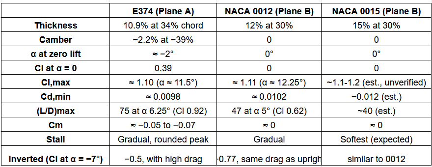
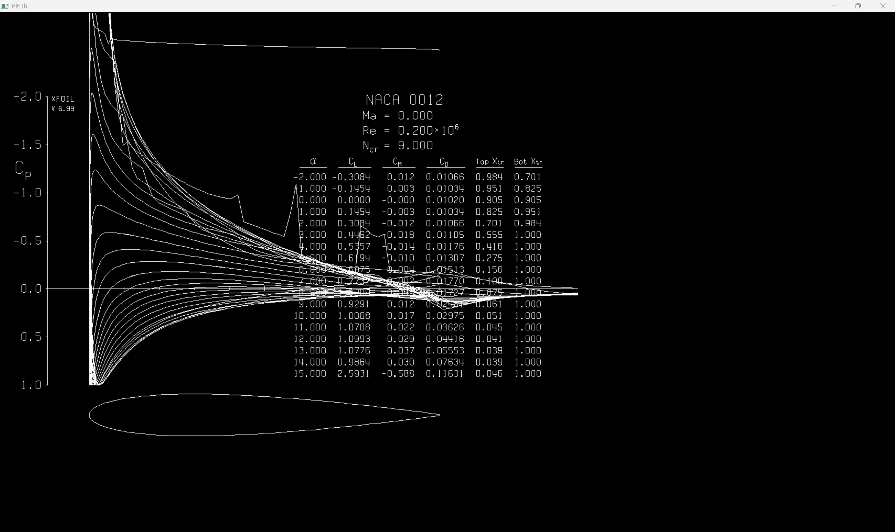

## Sources 
- [Airfoil Tools](http://airfoiltools.com/)
- [How to select an Airfoil](https://www.youtube.com/playlist?list=PLEs9qAlCXfXHw3wrbvn2FUWhST-F1qdRp)
- [Airfoils For RC Model Aircraft](https://www.rcpano.net/airfoils-for-rc-model-aircraft/)
## Tools 
- [XFOIL](https://web.mit.edu/drela/Public/web/xfoil/)

## Research and Notes
- If we choose low drag coefficient , it means it might not have a good max lift coefficient , which means that the  stall speed will be high. If high lift coefficient , then drag coefficient also might be high. 
- Front camber means that the camber is towards the leading edge and if it is aft cambered , then the camber is towards the trailing edge of the airfoil. 
- Aerodynamic center is the point on the chord line, about which the pitching moment does not change with the angle of attack. It is generally at 25% of the chord. 
- $$C_m  = \frac {PM}{{\frac{1}{2}}\rho V^2 Sc}$$where the PM is the pitching moment and c is the chord. 
- $C_l \ vs \ C_d$ plot is called the airfoil's drag polar.  $C_{lmax}$ is the C$_l$ a which stall will occur. Higher its value , lower the stall speed.  
- Drag polar is much easier to use, here , we  include only the parasitic drag and not the induced drag. We can now choose the airfoil. 

## Plane  A 
 - Here , we need maximum payload. That depends on how much lift the wing makes at low, safe stall speed. 
 - Cambered airfoils will give more lift at given speed and angle, so we can carry more weight. 
 - For this purpose I will be choosing Clark Y , NACA 2412 or Eppler 374. 
 - Clark Y has been historically used in cargo and utility aircraft. It has a flat lower surface, positive camber, deep internal wing spars. The camber allows it to produce maximum lift even at low speeds. It also has a benign, gradual stall progression, which causes the flow separation to happen progressively rather than simultaneously. 
 - NACA 2412 is the most thoroughly studied and widely applied airfoil. It has high L/D ratio at moderate angles, the smooth rounding of edges allows it to sustain heavy loads by preventing the premature flow separation. It has highly optimized camber to thickness ratio. 
 - Eppler 374 is s specialized highly efficient airfoil, frequently used for heavy lift aircrafts. It is designed to have high lift coefficient at moderate Reynold's numbers. It is thinner than Clark Y but has profile to minimize the skin friction and resist massive G-forces and bending stresses inflicted by maximum payloads. 

## Plane B 
- Here , we require maximum maneuverability, which means , we must have symmetrical profiles with zero camber/curvature. We must also ensure that it has low / zero pitching moment, which will ensure that the control forces remain predictable and linear across a wide range of speeds and angles of attacks. 
- NACA 0012 will have lower drag and offers a rapid roll and pitch rate due to thinner profile. 
- NACA 0015 has bending rigidity (during high G maneuvers). It also has a thicker leading edge radius, which softens the stall characteristics. 

## Deep Comparison of  E374 and NACA 0012 

- The data has been taken from the first link in the Sources.
- The Cl max is identical for both E374 and NACA 0012 , however , the advantage of E374 is the L/D at the mid Cl range, since lift is available at lower angle of attack. 
- At negative angles , E374 lift peaks around [Cl = -0.54](http://airfoiltools.com/airfoil/details?airfoil=e374-il) ,  with heavy drag, against -1.1 for NACA 0012. Therefore , NACA 0012 is very good for high maneuverability. 

## How geometry affects the performance
- Camber : It shifts the Cl vs alpha curve up, naturally generating lift. With camber , we must pitch slightly downward before the wing stops lifting. Ex : E374 has Cl of 0.39 at 0 degree angle of attack. 
- Thickness : A thicker airfoil will give more physical interior height to build deep, heavy duty wing structures. It also gives a softer stall. However it drives the L/D ratio lower. 
- Leading Edge radius : A larger , rounded leading edge handles higher angle of attack better. This gives a softer more progressive stall and higher maximum lift coefficient. NACA 0012 has a generous leading edge radius giving us predictable stall characteristics. 
- Symmetry : Happens when the upper and lower halves , already discussed while writing for NACA 0012, same cheez baar baar nhi likhunga. 

- Chord length : Longer length will result in higher Reynold's number , higher lift and larger surface area. 
- Aspect Ratio : Higher aspect ratio will reduce the wingtip vortices, which will cause high aerodynamic efficiency and L/D ratio. However, it causes extreme bending moments. Low aspect ratio can however withstand extreme G-Forces. 

## Can an Airfoil satisfy both the Requirements ? 
- Payload will require a lift at low angle of attack , good L/D at Cl is the range of 0.6 to 0.9. This will require some camber. However maneuverability will require symmetry (no camber) . 
- Inverted flights will become noticeably different and less efficient if cambered airfoil is used. 
- Cambered airfoils also want to twist downward (nose down pitching moment), which will cause the tail to constantly apply downwards force to keep nose from dropping. 
- Further, to carry a heavy cargo , we must have a thicker profile to withstand heavy G force. However, to snap , roll and accelerate , we need thin , sleek profile with minimal drag. 
- Therefore , we must choose airfoil according to the requirements. 

##  XFOIL Plots

### NACA 0012  

